# The Fabric Triage Solution Accelerator

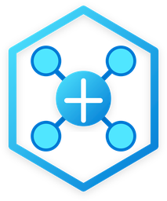

The **Fabric Triage Solution Accelerator** is an MIT-licensed reference architecture built on Azure AI Foundry, Azure SQL Database, Power BI, and Microsoft Fabric. It runs a multi-agent operations loop for semantic model refresh failures and scheduled Fabric pipeline failures while keeping every write action, budget limit, and approval gate inside deterministic Python and SQL controller code.

The entire system also runs **fully offline** on a workstation using mock providers and fixture state:
- No Azure subscription, Entra credentials, or network access are required to run the CLI or the test suite.
- The 15 YAML scenarios in [`scenarios/`](./scenarios) execute against the exact same `TriageRunner`, `PolicyLedger`, and `ToolDispatcher` code path used in Azure.

> **Note:** This is an independently maintained developer sample. It is not a Microsoft product and carries no support agreement. See [Disclaimers](#disclaimers).

## Table of contents

- [Problem and authorization boundary](#problem-and-authorization-boundary)
  - [Failure modes in a Power BI and Fabric estate](#failure-modes-in-a-power-bi-and-fabric-estate)
  - [Why prompt wording is not an authorization boundary](#why-prompt-wording-is-not-an-authorization-boundary)
  - [Capabilities included in this accelerator](#capabilities-included-in-this-accelerator)
- [Azure and Microsoft Fabric architecture](#azure-and-microsoft-fabric-architecture)
  - [Cloud deployment topology and SQL role separation](#cloud-deployment-topology-and-sql-role-separation)
  - [Multi-agent control loop and policy boundary](#multi-agent-control-loop-and-policy-boundary)
  - [Triage controller (`src/triage/runner.py`)](#triage-controller-srctriagerunnerpy)
  - [Triage agent and tool dispatcher (`src/triage/tools/registry.py`)](#triage-agent-and-tool-dispatcher-srctriagetoolsregistrypy)
  - [Data quality agent (`src/triage/agents/data_quality_agent.py`)](#data-quality-agent-srctriageagentsdata_quality_agentpy)
  - [Silent-failure detector (`src/triage/silent_failure.py`)](#silent-failure-detector-srctriagesilent_failurepy)
  - [Monitoring worker (`src/triage/monitoring/worker.py`)](#monitoring-worker-srctriagemonitoringworkerpy)
  - [Shared Azure SQL state store (`src/triage/store/` and `src/triage/monitoring/`)](#shared-azure-sql-state-store-srctriagestore-and-srctriagemonitoring)
- [Triage Command Center walkthrough](#triage-command-center-walkthrough)
  - [Command Center overview and incident queue](#command-center-overview-and-incident-queue)
  - [Tier-2 remediation proposal and fingerprint approval gate](#tier-2-remediation-proposal-and-fingerprint-approval-gate)
  - [System overview and operational safeguards](#system-overview-and-operational-safeguards)
  - [Hybrid monitoring setup and workspace scope](#hybrid-monitoring-setup-and-workspace-scope)
  - [Incidents directory and full incident record](#incidents-directory-and-full-incident-record)
  - [Turn-by-turn run inspector and PolicyLedger timeline](#turn-by-turn-run-inspector-and-policyledger-timeline)
  - [Knowledge playbooks, scenario validation, and Entra access roles](#knowledge-playbooks-scenario-validation-and-entra-access-roles)
- [Twelve non-negotiable engineering rules](#twelve-non-negotiable-engineering-rules)
- [Run the solution on your workstation](#run-the-solution-on-your-workstation)
  - [Set up the Python environment](#set-up-the-python-environment)
  - [Run the offline test suite](#run-the-offline-test-suite)
  - [Run a scenario from the CLI](#run-a-scenario-from-the-cli)
  - [Executable scenario specifications (`scenarios/`)](#executable-scenario-specifications-scenarios)
- [Deploy into an Azure and Fabric tenant](#deploy-into-an-azure-and-fabric-tenant)
  - [Prerequisites and costs](#prerequisites-and-costs)
  - [Scheduling: Logic Apps heartbeat vs Foundry routines](#scheduling-logic-apps-heartbeat-vs-foundry-routines)
  - [Hybrid monitoring scope and limits](#hybrid-monitoring-scope-and-limits)
- [Security guidelines](#security-guidelines)
- [Live verification status](#live-verification-status)
- [Customize the solution](#customize-the-solution)
- [Supporting documentation](#supporting-documentation)
- [Feedback, transparency and disclaimers](#feedback-transparency-and-disclaimers)

## Problem and authorization boundary

Power BI semantic models and Fabric data pipelines fail regularly in production estates:
- A scheduled semantic model refresh fails at 06:02 with a generic mashup error and sends an email alert.
- A scheduled Fabric data pipeline fails overnight on a copy or notebook activity and sits broken until someone opens a report.
- A refresh completes with an HTTP 200 status against an upstream table that never loaded today's rows, leaving the model stale with no alert at all.

Responding by hand follows the same checklist every time: open the refresh or job history, inspect the error code and gateway status, check whether upstream tables have duplicate keys or missing data, decide if a retry can actually clear the failure, and either trigger a single retry or route the incident to the data owner.

### Failure modes in a Power BI and Fabric estate

Giving a language model direct access to the Power BI and Fabric REST APIs and telling it to "fix refresh failures" breaks down across four concrete failure modes:

- **Error strings are ambiguous without runtime evidence:**
  - `DM_GWPipeline_Gateway_MashupDataAccessError` can mean a transient network blip, an expired credential, an offline on-premises gateway, or a source SQL server refusing connections.
  - A retry fixes the transient blip and wastes time on the other three.
  - Distinguishing them requires reading the refresh history, gateway status, and recent successful runs before choosing an action.
- **Silent data failures emit no alert:**
  - A semantic model refresh that reads an empty or truncated staging table succeeds at the Power BI service layer.
  - A pipeline that loads 10% of its normal row volume still reports a succeeded job run.
  - Catching silent failures requires deterministic row-count, freshness, and schema probes against recorded baselines.
- **Remediation actions have real blast radius:**
  - Triggering a refresh on a dataset that is already refreshing queues conflicting load on the capacity.
  - Rerunning a multi-step Fabric pipeline that already committed an early copy activity can duplicate rows in a production table if the pipeline is not idempotent.
- **One root cause generates repeating alerts:**
  - A single offline gateway or locked service principal triggers a new failure every 30 minutes across dozens of models.
  - Triaging and announcing every occurrence independently spams the operations channel and burns remediation budgets.

### Why prompt wording is not an authorization boundary

When an agent is allowed to invoke tools directly, whatever the model proposes executes immediately:
- Putting "only refresh a dataset once" or "never rerun an unreviewed pipeline" inside a system prompt is a suggestion, not a hard limit.
- Untrusted text read during the run—including an incoming email body, an error message from an external source, or an incident note—can steer the model into ignoring prompt instructions.

This accelerator splits "can the agent do this?" into three separate code-enforced checks outside the model:

| Question | Mechanism | Where it is enforced |
|---|---|---|
| Is this action ever permitted in this system? | Action allowlists (`DIAGNOSTIC_ACTIONS`, `REMEDIATION_ACTIONS`, `REPORTING_ACTIONS`) | `src/triage/policy.py`, checked in `ToolDispatcher` before any tool call runs |
| Has this incident already used its action or turn budget? | Shared `PolicyLedger` (max 5 turns, 8 tool calls, 1 remediation, 1 notification) | `src/triage/policy.py`, shared across every agent in the run |
| Did an authorized human approve this exact high-impact action? | Single-use, unexpired approval record bound to `sha256(incident_id, action, canonical_args)` | `triage_approvals` in Azure SQL, verified atomically before dispatch |

The reasoning agents hold **zero Azure, Fabric, Power BI, Graph, or SQL permissions**. The agents propose; the deterministic controller checks the allowlist, ledger, preconditions, and SQL fences before executing with its own managed identity.

### Capabilities included in this accelerator

- Evidence-based triage for Power BI semantic model refreshes (`PowerBI.Dataset`) and admitted scheduled Fabric data pipelines (`Fabric.DataPipeline`).
- Hard budgets and tool allowlists enforced in `PolicyLedger` and `ToolDispatcher`, with unit tests proving every limit fires.
- Fingerprint-bound human approval gates for Tier-2 actions (`rebind_report` and `rerun_pipeline`).
- Deterministic data quality table scans (`DataQualityAgent`) and silent-failure baseline probes (`SilentFailureDetector`).
- Hybrid estate monitoring (`bitriage-monitoring-worker`) combining Fabric REST inventory/polling with native Fabric Job Eventstream intake.
- Single shared **Azure SQL Database** (`bitriage-state`) with least-privilege SQL role separation (`worker`, `web`, `controller`) enforced through checked views and fixed stored procedures.
- Secretless React + FastAPI **Triage Command Center** (`bitriage-command-center`) secured by Entra ID JWT app-role claims (`Reader`, `Operator`, `Approver`, `Admin`).
- Single-announcement deduplication (`notified_count`) and guaranteed terminal outcome persistence across all 12 outcome states.

## Azure and Microsoft Fabric architecture

### Cloud deployment topology and SQL role separation

All live application state lives in one shared **Azure SQL Database** (`bitriage-state`) configured with Microsoft Entra-only authentication, TLS 1.2+, SQL auditing, and explicit firewall rules. Around that database sit five operational planes:

1. **Monitored Estate (Microsoft Fabric & Power BI):** Semantic models, scheduled data pipelines, workspace metadata APIs, and an app-owned Fabric Eventstream (`workspace.jobevents`) streaming native `ItemJobEvent` records over AMQP/TLS.
2. **Monitoring & Intake Plane (Azure Container Apps):** A no-ingress container worker (`bitriage-monitoring-worker`) that discovers workspaces and items, polls REST execution history, and consumes Eventstream job events using a pinned User-Assigned Managed Identity.
3. **Operator & Governance Plane (Azure App Service):** The React 18 + FastAPI Command Center (`bitriage-command-center`) where operators configure workspace scopes, review pipeline replay safety, inspect runs, and approve or deny Tier-2 actions.
4. **Control & Reasoning Plane (Azure AI Foundry):** The hosted controller (`bi-triage-controller`) triggered every minute by a Consumption Logic App (`bitriage-heartbeat`), paired with zero-permission `gpt-4.1-mini` prompt agents for triage, data quality interpretation, and incident Q&A.
5. **Shared Durable State Plane (Azure SQL Database):** One database accessed through three segregated SQL database roles (`triage_monitoring_worker`, `triage_monitoring_web`, `triage_monitoring_controller`) over 27 fixed stored procedures and 3 role-scoped views (`worker_read`, `web_read`, `controller_read`).

| 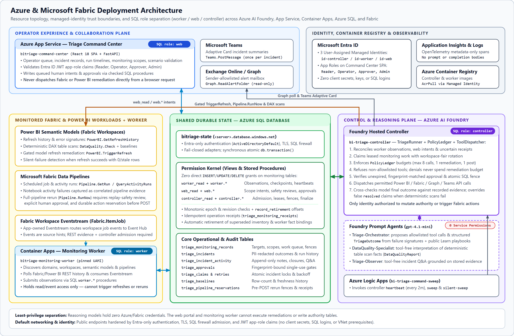 |
| --- |
| *Cloud deployment topology across Microsoft Fabric, Azure Container Apps, Azure App Service, Azure SQL Database, and Azure AI Foundry. ([View high-resolution SVG](./docs/images/readme/azure-architecture.svg))* |

### Multi-agent control loop and policy boundary

Inside the hosted controller, `TriageRunner` and `ToolDispatcher` mediate every step between the language model and the external APIs:

| 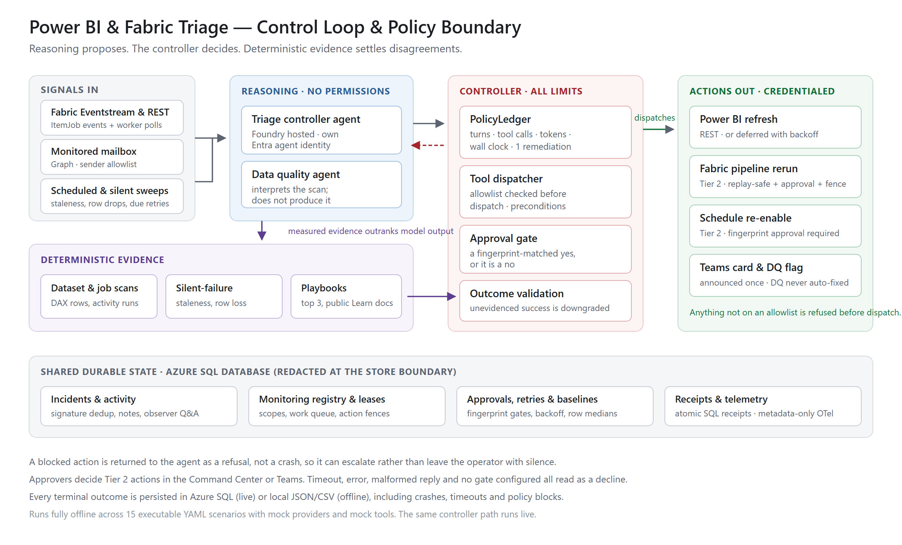 |
| --- |
| *Internal control loop showing intake sources, `TriageRunner` orchestration, `PolicyLedger` budgets, `ToolDispatcher` gates, and the 12 terminal outcomes. ([View high-resolution SVG](./docs/images/readme/solution-architecture.svg))* |

### Triage controller (`src/triage/runner.py`)

`TriageRunner` owns orchestration outside the model. When an alert, polled failure, or admitted job event arrives, the controller executes four deterministic steps:

1. Parses the failure context and computes a stable **failure signature** (`target_id + error_code`) that stays identical even when alert wording or timestamps change.
2. Queries Azure SQL for an open incident matching that signature:
   - If an open incident already exists, the controller increments `occurrence_count` and exits as `duplicate_suppressed` without re-running remediation or sending a second Teams notification (`notified_count` is enforced in code, never in prompt wording).
   - If no open incident exists, the controller acquires an atomic SQL lease (`triage_claims`) so concurrent heartbeats cannot triage the same failure twice.
3. Constructs the agents and initializes a fresh `PolicyLedger` for the run.
4. Persists the terminal outcome to `triage_incidents` before releasing the run.

Every triage run terminates in exactly one of twelve persisted outcomes:

```text
resolved · deferred_retry · needs_human · flagged_data_quality ·
duplicate_suppressed · declared_failed · approval_denied · policy_blocked ·
budget_exceeded · max_turns_exceeded · timed_out · agent_crashed
```

### Triage agent and tool dispatcher (`src/triage/tools/registry.py`)

`TriageAgent` runs the reasoning loop (`max_turns=5`) and has no direct network or SDK handles. When the model proposes a tool call, `ToolDispatcher` runs four checks in order:

1. **Charges the shared `PolicyLedger`:**
   - Turn count (`max_turns=5`), tool calls (`max_tool_calls=8`), tokens (`max_total_tokens=16,000`), remediation writes (`max_remediation_actions=1`), Teams posts (`max_teams_posts=1`), and wall-clock time (`timeout_seconds=60`) are tracked across the entire run.
   - Delegating to a sub-agent shares the same ledger so a child call cannot reset a spent budget.
2. **Checks the action allowlists in `src/triage/policy.py`:**
   - Every tool must appear in `DIAGNOSTIC_ACTIONS`, `REMEDIATION_ACTIONS`, or `REPORTING_ACTIONS` (or `PIPELINE_DIAGNOSTIC_ACTIONS` / `PIPELINE_REMEDIATION_ACTIONS` for pipeline runs).
   - Any tool name off the allowlist (such as `delete_dataset`) is refused immediately before dispatch.
3. **Verifies deterministic preconditions:**
   - Refuses `refresh_dataset` if the semantic model already has a refresh in progress.
   - Refuses `rerun_pipeline` unless the pipeline's target safety review is `verified` for `full_pipeline_rerun`, its definition hash still matches the reviewed artifact, and no active run is already in flight.
4. **Verifies approval state for Tier-2 actions:**
   - `rebind_report` and `rerun_pipeline` require an explicit, unexpired, unused approval record matching `sha256(incident_id, action, canonical_args)`.
   - If an approval is denied or missing, the refusal is returned to the model as a tool result **without consuming `remediation_count`**, so one human denial does not disarm the agent for an alternative permitted fix.

After the model proposes a final outcome, the controller cross-checks that claim against recorded tool calls and deterministic scan evidence. If the model claims `resolved` when a data quality scan failed or when a submitted pipeline rerun is still in progress, the controller overrides the outcome (`flagged_data_quality` or `needs_human`) and logs the disagreement.

### Data quality agent (`src/triage/agents/data_quality_agent.py`)

Refresh failures caused by duplicate keys, null business keys, or broken foreign-key joins in an upstream Lakehouse table cannot be fixed by retrying Power BI.

`DataQualityAgent` separates evidence collection from model interpretation:
- The controller first runs deterministic table scans against the registered source tables to measure duplicate keys, null ratios, row-count drops, and schema drift.
- The controller then passes those structured scan findings to a **tool-free** model call (`DataQualityAgent`) that formats a typed Pydantic report (`DataQualityReport`).
- Because the model call has no tools, it cannot skip a table scan or invent its own query results.

### Silent-failure detector (`src/triage/silent_failure.py`)

`SilentFailureDetector` catches refreshes and pipeline loads that report success at the service layer while delivering stale or truncated data:
- Compares current table freshness, row counts, and column schemas against configured expectations and historical baselines in `triage_baselines`.
- Runs deterministically without calling an LLM, because a language model asked whether a 60% row drop is acceptable will occasionally rationalize it.
- Whenever a deterministic scan and a model claim disagree, the deterministic scan wins.

### Monitoring worker (`src/triage/monitoring/worker.py`)

`bitriage-monitoring-worker` is a no-ingress background worker running on Azure Container Apps. It discovers workspaces and items in the tenant, polls Power BI and Fabric execution history over REST, reconciles app-owned Eventstream bindings, and receives native Fabric Job events.

Worker observations are treated as **untrusted evidence, never operational authority**:
- **An Eventstream message is a pointer, not proof of failure:** Native Fabric job events trigger a targeted REST inspection and still require controller admission before any triage run starts.
- **Discovery never grants remediation authority:** Discovering 1,400+ items across a tenant populates the inventory catalog so an Admin can see what exists, but nothing is polled or remediated until an Admin activates a scope and completes a safety review.
- **Database roles enforce the boundary in SQL:**
  - `worker` can only call observation stored procedures (`triage_mon_worker_*`) and read `worker_read`.
  - `web` can only submit operator intents (`triage_mon_web_*`) and read `web_read`.
  - Only `controller` (`triage_mon_controller_*`) can publish scope authority, advance source heads, reserve actions, or finalize incidents.

The end-to-end state flow through Azure SQL runs as follows:
- **Step 1 (Web intent):** An Admin or Approver submits a scope change, safety review, or approval in Command Center, writing a `pending_validation` intent via `web` RPCs.
- **Step 2 (Worker observation):** The monitoring worker writes workspace inventory, REST execution observations, and Eventstream job receipts via `worker` RPCs.
- **Step 3 (Deterministic controller reconciliation):** On each heartbeat, `bi-triage-controller` drains `reconcile_state` work items deterministically (with no LLM calls) to validate worker observations and web intents and publish authoritative registry, source, and connector records.
- **Step 4 (Admitted triage & fenced execution):** The controller claims leased monitoring work with workspace-fair rotation, checks admission, policy, approval, and an atomic pre-POST reservation (`triage_pipeline_reservations`), executes the permitted action, and verifies completion over REST.

### Shared Azure SQL state store (`src/triage/store/` and `src/triage/monitoring/`)

All durable state lives in one shared Azure SQL Database (`bitriage-state`) so cross-store receipts, action fences, and incident finalization commit in a single synchronous SQL transaction (`AzureSqlDatabase.transaction()`):

- **Stores fail closed:** If Azure SQL is unreachable, stores raise an error and re-check on the next call rather than falling back to in-memory dicts. An in-memory fallback would answer "no open incident" after a restart and permit duplicate remediations.
- **Claims and work leases are atomic:** Conditional `UPDATE ... WHERE` and `UPDLOCK, HOLDLOCK` procedures evaluate lease expiry using SQL Server `SYSUTCDATETIME()` so clock skew between container instances cannot double-claim work.
- **No durable state lives on Python objects:** Hosted Foundry controller containers spin up fresh instances across requests. Every counter, claim, retry schedule, and approval lives in SQL.
- **Bounded retention keeps SQL Data IO flat:** Each 15-minute retention window retires up to 50 superseded inventory generations (>7 days old) and up to 1,000 superseded `accepted_fact` bindings (`fact_revision < r.revision`) while advancing `record_retirement` sequence offsets so `change_counter` remains strictly monotonic.

## Triage Command Center walkthrough

The **Triage Command Center** (`command-center/`) is a React 18 + FastAPI operational portal deployed on Azure App Service. Every screenshot below is captured live from the MorkNet reference deployment (`rg-bitriage-accel`) monitoring 1,458 Fabric and Power BI artifacts across 4 active workspaces.

### Command Center overview and incident queue

The main **Command Center** view gives operators a real-time KPI strip (active scopes, monitored targets, pending approvals, and open incidents), a filterable **Incident queue** on the left, and the **Command inspector** on the right. Browser requests never execute Power BI or Fabric mutations directly—every operator action writes a durable intent to Azure SQL that the controller drains on its next heartbeat.

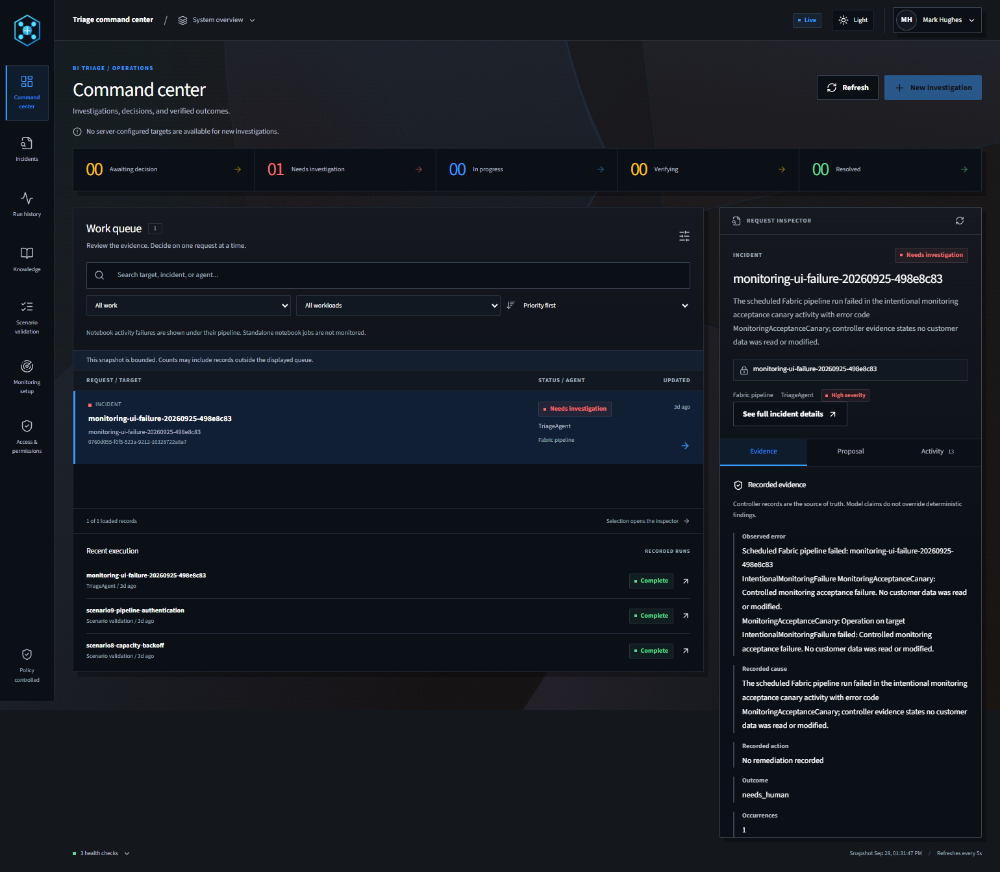

### Tier-2 remediation proposal and fingerprint approval gate

When the triage agent recommends a Tier-2 action—such as `Pipeline.RunNow` on a failed Fabric data pipeline (`pl_daily_claims_curated_load`) or `rebind_report` on a broken semantic model—the run pauses in `awaiting_approval` and surfaces in the **Proposal & Approval** tab. The approval card displays:
- The exact target identity, workspace ID, and failed job instance ID.
- The SHA-256 action fingerprint (`sha256(incident_id, action, canonical_args)`) and expiration timestamp.
- The verified target safety review (`full_pipeline_rerun`, `idempotent_overwrite`) alongside **Approve & queue execution** and **Deny proposal** controls restricted to `CommandCenter.Approver` and `CommandCenter.Admin`.

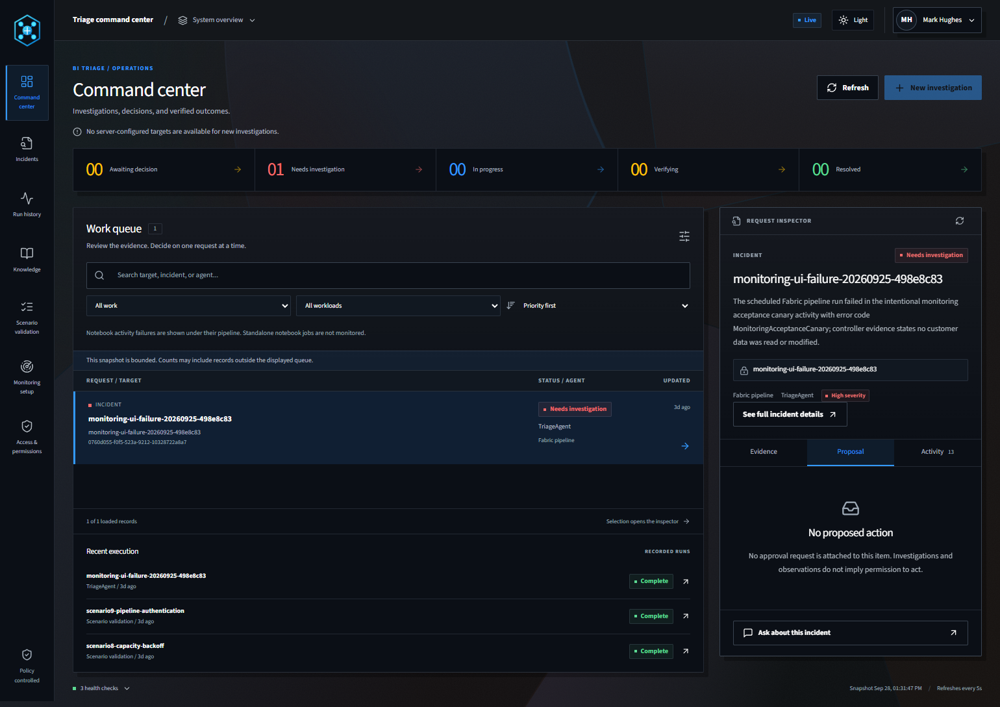

### System overview and operational safeguards

Clicking **How it works** in the top bar opens the **System overview** reference inside the portal, summarizing the three-stage operational flow (**1. Detect & Ingest**, **2. Investigate & Propose**, **3. Approve & Remediate**), the four Entra ID role tiers, and the controller's non-negotiable runtime bounds.

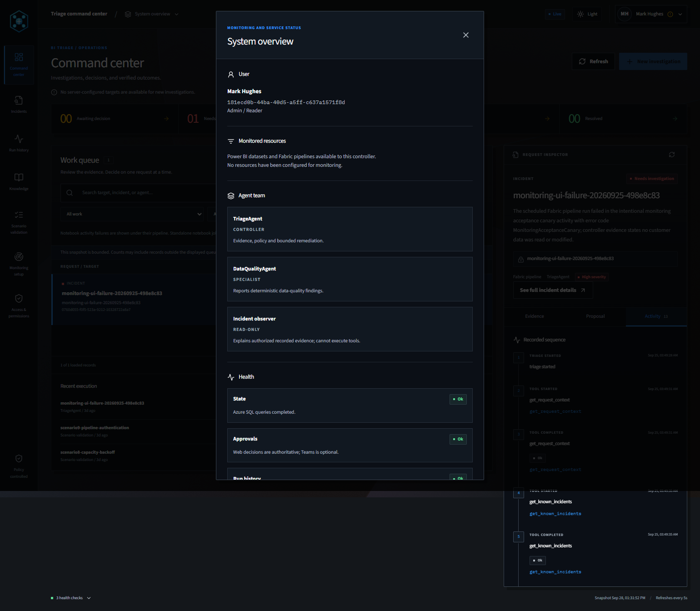

### Hybrid monitoring setup and workspace scope

The **Monitoring setup** page manages tenant discovery, workspace scope activation, Eventstream health, and per-pipeline replay safety reviews:
- **Runtime & Eventstream status:** Shows live worker freshness (`Fresh`), Eventstream mode (`event_enabled`, `Active`), and controller reconciliation status.
- **Workspace scope selector:** Lists discovered workspaces (332 discovered in the tenant; 4 workspaces with 1,458 targets enabled in scope).
- **Target safety reviews:** Allows Admins to attest replay posture (`full_pipeline_rerun`, `diagnostic_only`, or `blocked`) pinned to each pipeline's definition hash before any rerun can be proposed.

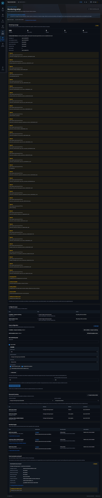

### Incidents directory and full incident record

The **Incidents** directory provides full-text search and filtering across every historical and active incident by status, workload (`Fabric.DataPipeline` vs `PowerBI.Dataset`), terminal outcome, and workspace:

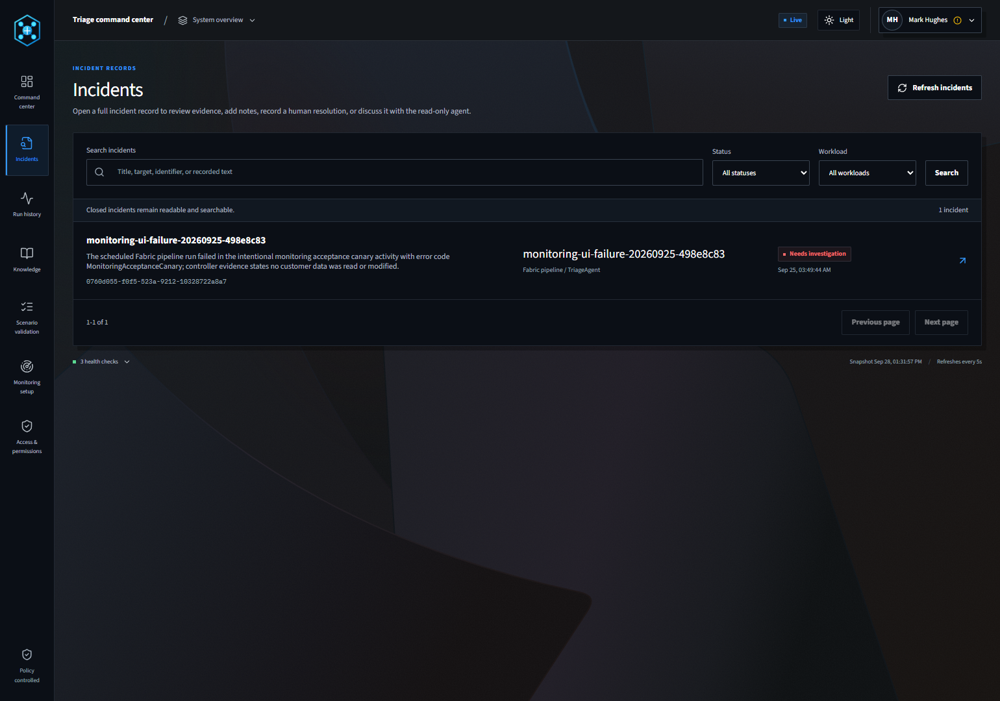

Opening an incident launches the **Full incident record** view, which combines:
- The structured failure evidence, classification (`transient`, `data_quality`, `capacity`, `permission`, `code_or_schema`), and SHA-256 prompt/schema hashes.
- Append-only operator notes and **Resolved by user** tracking (bound to the UTF-16 LE SHA-256 hash of the SQL `NVARCHAR` payload so new failure evidence automatically invalidates stale human closures without resetting remediation budgets).
- A persisted, tool-free **Observer Q&A** assistant that answers questions about the incident record without raw HTML, external links, or tool execution privileges.

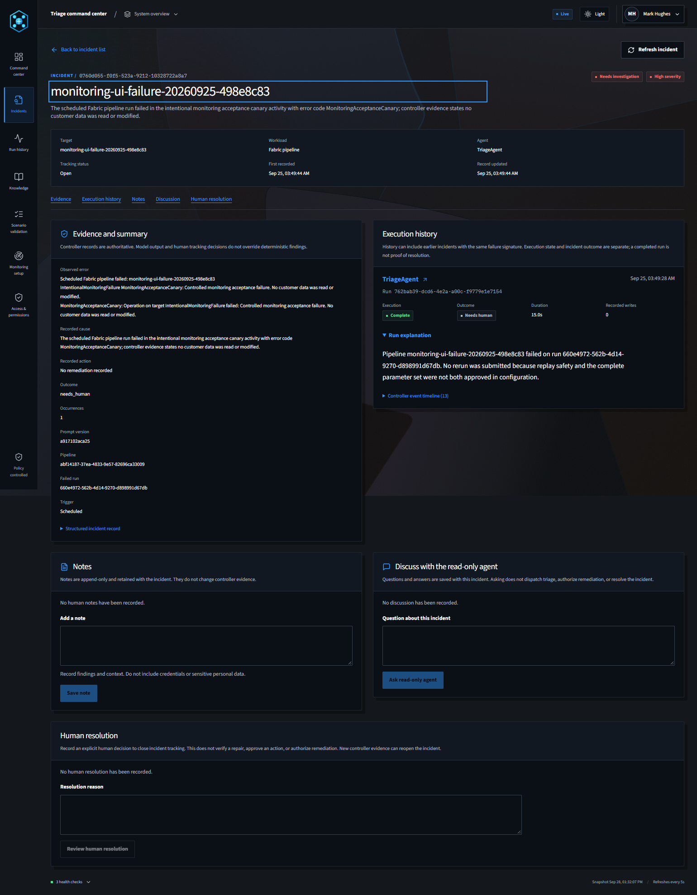

### Turn-by-turn run inspector and PolicyLedger timeline

The **Run history & inspector** tab inside the Command inspector renders the step-by-step execution trace for each triage attempt, showing:
- Every diagnostic tool call (`inspect_pipeline_run`, `query_activity_runs`, `lookup_playbook`) with its exact latency and structured output.
- Real-time `PolicyLedger` budget consumption (`turn_count`, `tool_call_count`, `remediation_count`, `notified_count`).
- Explicit controller blocks when a pipeline lacks a verified replay-safety review or when a second remediation is refused by policy.

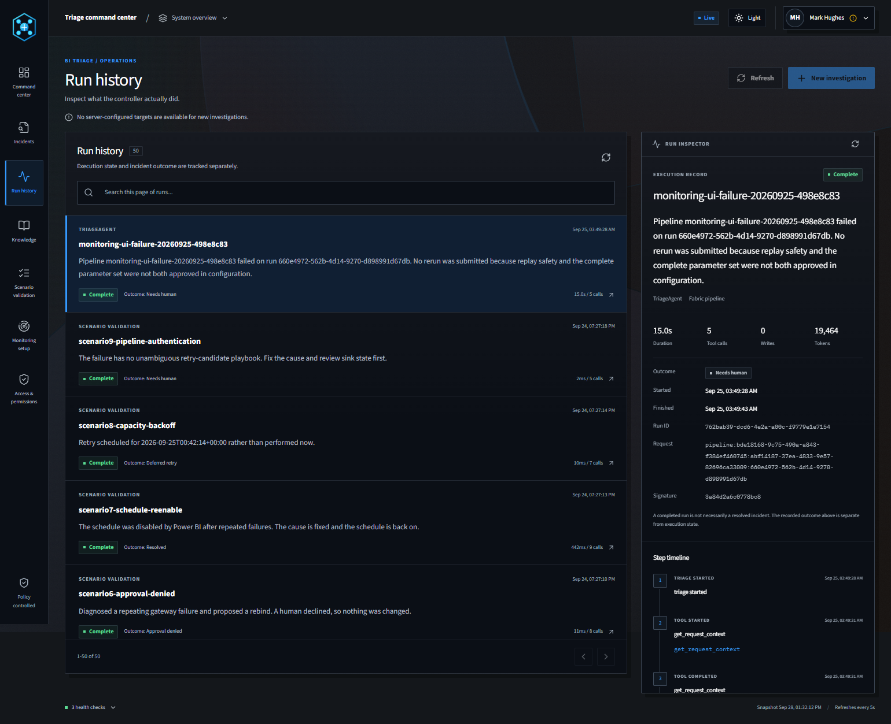

### Knowledge playbooks, scenario validation, and Entra access roles

The remaining three navigation tabs provide operational transparency and built-in verification:

- **Knowledge & playbooks:** Browses the curated failure playbooks in `src/triage/knowledge/playbooks.py`, showing error-text triggers, `retry_useful` verdicts, recommended diagnostic sequences, and public Microsoft Learn citations.

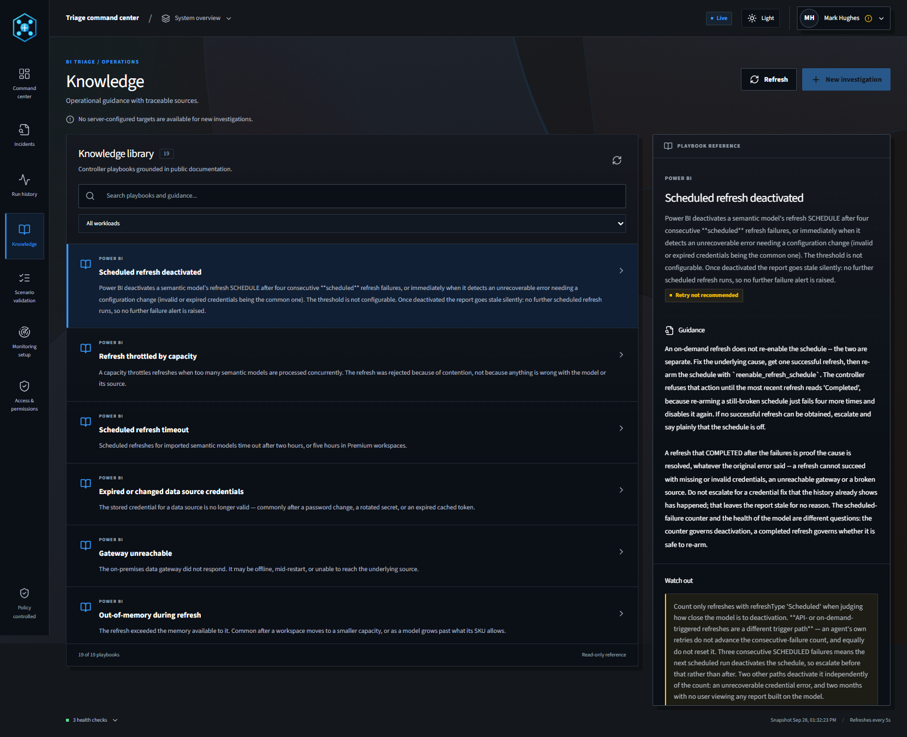

- **Scenario validation:** Executes all 15 offline YAML specifications in an isolated sandbox directly from the UI and verifies that every expected tool sequence, policy block, and terminal outcome passes (`15 / 15 passing`).

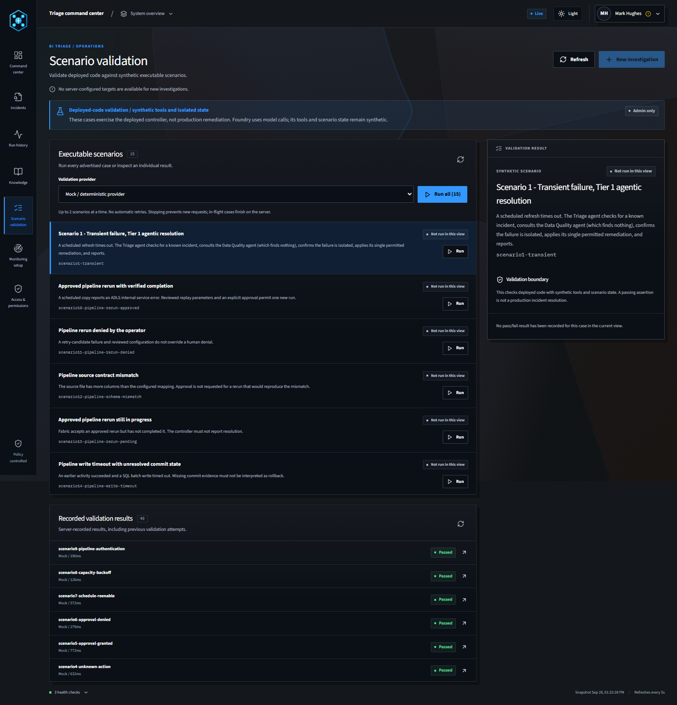

- **Access & permissions:** Displays the signed-in operator's effective Microsoft Entra ID app-role claims (`CommandCenter.Reader`, `CommandCenter.Operator`, `CommandCenter.Approver`, `CommandCenter.Admin`) and the capability matrix enforced by the FastAPI backend on every request.

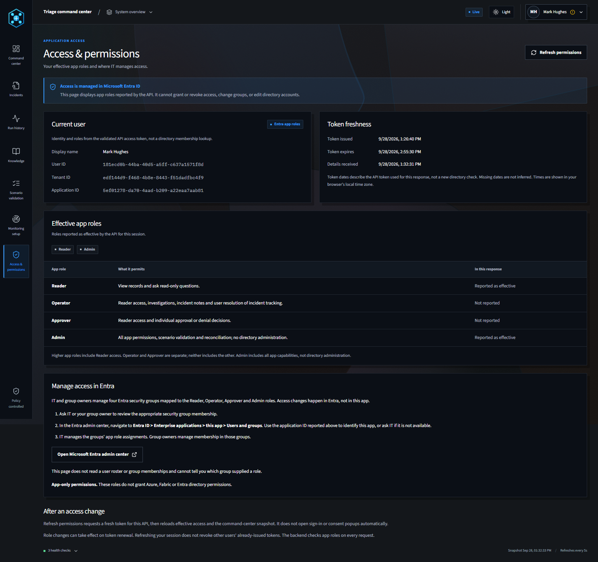

## Twelve non-negotiable engineering rules

Every module and test in this repository enforces twelve core rules:

1. **Policy is enforced in the controller, not the prompt.** Every budget in `src/triage/policy.py` is enforced by `PolicyLedger` with a test proving it fires.
2. **Every tool is on an explicit allowlist.** Any tool not in `DIAGNOSTIC_ACTIONS`, `REMEDIATION_ACTIONS`, or `REPORTING_ACTIONS` is refused before dispatch.
3. **An approval is only a yes if it is explicit, fingerprint-matched, unexpired, and unused.** Timeouts, errors, malformed replies, or unconfigured gates all evaluate to `no`.
4. **A denial never consumes the remediation budget.** Returning a denial without incrementing `remediation_count` allows the agent to fall back to a diagnostic escalation instead of locking up.
5. **An approval never authorizes an off-allowlist action.** Approvals gate permitted Tier-2 actions; they cannot bypass the allowlist.
6. **Deterministic evidence outranks model output.** When a table scan or REST status check disagrees with the model's claimed outcome, the controller overrides the model and logs the discrepancy.
7. **Grant permissions to the component that acts, not the one that reasons.** Prompt agents hold zero credentials or RBAC roles.
8. **The inbox filter is a security control.** Mailbox ingestion filters by sender allowlist and subject regex and fails closed when a pattern is invalid. Never widen the filter to make a test message pass—send a matching message instead.
9. **Tools fail loudly on invalid arguments.** Calling Power BI with an empty dataset ID raises a validation error before HTTP dispatch so the model never misinterprets an HTTP 404 as a deleted dataset.
10. **Telemetry spans carry metadata only.** Prompt and completion text are never attached to Application Insights spans.
11. **An incident is announced once, not once per occurrence.** Checked against `notified_count` in the controller before dispatching any Teams notification.
12. **Scenarios are reproducible.** Same input, same tool sequence, same numbers. Never weaken a policy limit to make a scenario pass.

## Run the solution on your workstation

Running offline requires no Azure subscription, no credentials, and no network access.

### Set up the Python environment

```powershell
python -m venv .venv
.\.venv\Scripts\python.exe -m pip install -e ".[dev]"
```

Select the explicit offline modes:

```powershell
$env:MONITORING_MODE = "fixture"
$env:TRIAGE_PROVIDER_MODE = "mock"
$env:TRIAGE_TOOL_MODE = "mock"
```

- `MONITORING_MODE=fixture` selects explicit offline monitoring state (`InMemoryMonitoringAdapter`).
- `TRIAGE_PROVIDER_MODE=mock` selects the deterministic state-machine provider in place of Azure OpenAI or Foundry.
- `TRIAGE_TOOL_MODE=mock` routes Power BI, Fabric, Graph, and Teams tool calls to local fixtures.

### Run the offline test suite

```powershell
.\.venv\Scripts\python.exe -m pytest -q
.\.venv\Scripts\python.exe -m ruff check .
.\.venv\Scripts\python.exe scripts\scan_secrets.py
```

The test suite makes zero network calls. `scripts/scan_secrets.py` is the CI credential gate that runs on every commit.

Run the Command Center frontend suite with:

```powershell
npm --prefix .\command-center test
npm --prefix .\command-center run lint
npm --prefix .\command-center run build
```

### Run a scenario from the CLI

```powershell
.\.venv\Scripts\bi-triage.exe list
.\.venv\Scripts\bi-triage.exe run scenario1-transient
```

Available CLI subcommands (`bi-triage`):

| Command | What it does |
|---|---|
| `bi-triage list` | Lists all 15 executable YAML scenarios |
| `bi-triage run <name>` | Runs a scenario end to end (`--verbose` prints turn-by-turn agent tool calls) |
| `bi-triage tools` | Prints the registered tool schemas |
| `bi-triage flags` | Displays the data quality flag table |
| `bi-triage incidents` | Displays persisted incidents and terminal outcomes |
| `bi-triage retries` | Lists deferred retries (`--drain` executes due retries) |
| `bi-triage commands` | Inspects or drains queued Command Center operator intents |
| `bi-triage preflight` | Verifies environment configuration, including Azure SQL connectivity |
| `bi-triage pipelines` | Runs pipeline triage or checks registry preflight (`--preflight`) |
| `bi-triage identity` | Verifies runtime Entra identity posture (`--check-scope`) |
| `bi-triage watch` | Polls a configured mailbox and triages matching alert messages |
| `bi-triage serve` | Launches the Command Center FastAPI + React application locally |
| `bi-triage reset` | Clears local offline flags and incident files |

### Executable scenario specifications (`scenarios/`)

The 15 YAML files in [`scenarios/`](./scenarios) are executable specifications. Each file defines the incoming failure, the mock service responses, and an `expect` block stating the exact tool call sequence and terminal outcome that must occur. `tests/test_scenarios.py` runs all 15 scenarios through `TriageRunner` on every test run:

| Scenario | Terminal outcome | What it verifies |
|---|---|---|
| `scenario1-transient` | `resolved` | A semantic model refresh times out. The agent checks for an open incident, runs the data quality scan (clean), confirms the failure is isolated, and executes its single permitted refresh retry. |
| `scenario2-data-quality` | `flagged_data_quality` | A duplicate-key refresh failure. `DataQualityAgent` scans the upstream table deterministically, identifies the offending business keys, and flags the table without retrying the refresh. |
| `scenario2b-known-issue` | `duplicate_suppressed` | The same alert arrives a second time while the incident is open. The controller matches the failure signature, increments `occurrence_count`, and suppresses duplicate remediation and notification. |
| `scenario3-policy-block` | `needs_human` | After one refresh retry fails to clear the issue, the agent proposes a second refresh. `PolicyLedger` refuses the second remediation, returns the refusal as a tool result, and the agent escalates to `needs_human`. |
| `scenario4-unknown-action` | `needs_human` | The agent proposes `delete_dataset`, which is not on any allowlist. `ToolDispatcher` blocks the call before dispatch and the agent escalates cleanly. |
| `scenario5-approval-granted` | `resolved` | A gateway failure repeats three days in a row. The agent proposes `rebind_report` (Tier-2), an Approver grants a fingerprint-matched approval, and the rebind succeeds. |
| `scenario6-approval-denied` | `approval_denied` | Identical to scenario 5 until the human denies the approval gate. The rebind never runs, the denial does not consume the remediation budget, and the run ends as `approval_denied`. |
| `scenario7-schedule-reenable` | `resolved` | Power BI automatically disabled a dataset's refresh schedule after four consecutive failures. The agent verifies upstream health and re-enables the schedule. |
| `scenario8-capacity-backoff` | `deferred_retry` | The Fabric capacity is throttled/saturated. Instead of adding load with an immediate retry, the controller schedules a deferred backoff retry in `triage_retries`. |
| `scenario9-pipeline-authentication` | `needs_human` | A scheduled Fabric pipeline copy activity fails with SQL authorization denied. Because an unchanged rerun cannot fix missing RBAC/credentials, the agent escalates without requesting rerun approval. |
| `scenario10-pipeline-rerun-approved` | `resolved` | A scheduled pipeline fails on a transient ADLS internal service error. Verified replay safety plus an explicit human approval reserve and execute one new pipeline run, then verify job completion. |
| `scenario11-pipeline-rerun-denied` | `approval_denied` | A retry-eligible pipeline failure with verified replay safety is denied by the human approver. No POST is sent to Fabric and the run terminates as `approval_denied`. |
| `scenario12-pipeline-schema-mismatch` | `needs_human` | A source file has more columns than the pipeline mapping allows. The agent identifies the deterministic schema mismatch and escalates without proposing a rerun. |
| `scenario13-pipeline-rerun-pending` | `needs_human` | Fabric accepts an approved pipeline rerun (`202 Accepted`), but the job is still running when the verification window closes. An accepted HTTP POST is not treated as `resolved`. |
| `scenario14-pipeline-write-timeout` | `needs_human` | An earlier pipeline activity succeeded before a downstream SQL batch write timed out. Because partial writes cannot be assumed rolled back, replay is refused and escalated to a human. |

## Deploy into an Azure and Fabric tenant

Offline evaluation requires no cloud resources. Deploying live into an Azure and Microsoft Fabric tenant requires provisioning the shared **Azure SQL Database**, the **Azure AI Foundry** project and hosted controller, the **Azure Container Apps** monitoring worker, the **Consumption Logic App** heartbeat scheduler, and the **Azure App Service** Command Center.

Prepare the Foundry project, the Azure SQL state database, and the monitored Fabric workspaces before starting any runtime container:
- [`docs/DeploymentGuide.md`](./docs/DeploymentGuide.md) orders every deployment step by lead time and documents the schema and role installation commands.
- [`docs/AzureAccountSetUp.md`](./docs/AzureAccountSetUp.md) covers subscription quotas, Entra app registrations, and RBAC prerequisites.

Live deployments require `MONITORING_MODE=live`, a pinned `MONITORING_TENANT_ID`, `AZURE_SQL_SERVER`, `AZURE_SQL_DATABASE`, managed-identity SQL role grants, and the deployed SQL permission kernel. Live mode never falls back to fixture state, and `FABRIC_PIPELINE_TARGETS` is retired in favor of the SQL monitoring registry.

The default deployment uses **public endpoints protected by Microsoft Entra authentication, TLS 1.2+, SQL firewall admission, and JWT app-role authorization**—no private endpoints, VNets, NAT Gateways, or private DNS zones are required for the baseline architecture.

> **Preview notice:** Foundry hosted agents, Entra agent identities, and Foundry routines use preview platform capabilities that may change without notice.

### Prerequisites and costs

To deploy into Azure, you need an [Azure subscription](https://azure.microsoft.com/free/) with:
- **Contributor** and **User Access Administrator** (or RBAC role-assignment permissions) at the subscription or resource-group scope.
- Permission in Microsoft Entra ID to create App Registrations and security groups for the four Command Center app roles.

The Bicep templates provision one shared `S1` Azure SQL application database (`bitriage-state`) and an optional `Basic` isolated proof database on the same logical server, with no elastic pool required. Microsoft Fabric capacity is used only for your monitored Fabric workloads and Eventstream—never for application state storage.

> **Note:** Actual costs depend on your selected SKUs, region, log volume, and polling frequency.

| Product | Role in this architecture | Cost |
|---|---|---|
| [Azure AI Foundry](https://learn.microsoft.com/azure/ai-foundry/) | Hosts `bi-triage-controller` and the three `gpt-4.1-mini` prompt agents, and issues the Entra agent identity used by the controller. | [Pricing](https://azure.microsoft.com/pricing/details/ai-foundry/) |
| [Power BI](https://learn.microsoft.com/power-bi/) | Monitored semantic model estate. The controller reads refresh history, triggers refreshes, re-enables schedules, and rebinds reports. | [Pricing](https://www.microsoft.com/power-platform/products/power-bi/pricing) |
| [Azure SQL Database](https://learn.microsoft.com/azure/azure-sql/database/) | Single shared state database (`bitriage-state`) holding monitoring scope, inventory, work leases, incidents, approvals, claims, baselines, and action fences under Entra-only auth. | [Pricing](https://azure.microsoft.com/pricing/details/azure-sql-database/) |
| [Microsoft Fabric](https://learn.microsoft.com/fabric/) | Monitored Data Pipelines, Lakehouse tables scanned for data quality, and native `workspace.jobevents` Eventstream delivery. | [Pricing](https://azure.microsoft.com/pricing/details/microsoft-fabric/) |
| [Azure Container Apps](https://learn.microsoft.com/azure/container-apps/) | Runs the no-ingress `bitriage-monitoring-worker` container in a Consumption environment. | [Pricing](https://azure.microsoft.com/pricing/details/container-apps/) |
| [Azure Container Registry](https://learn.microsoft.com/azure/container-registry/) | Basic SKU registry storing worker and controller container images with managed-identity pull (`AcrPull`) and admin/anonymous access disabled. | [Pricing](https://azure.microsoft.com/pricing/details/container-registry/) |
| [Azure Logic Apps](https://learn.microsoft.com/azure/logic-apps/) | Consumption workflow (`bitriage-heartbeat`) that triggers the controller `heartbeat` every minute using managed identity. | [Pricing](https://azure.microsoft.com/pricing/details/logic-apps/) |
| [Azure App Service](https://learn.microsoft.com/azure/app-service/) | Hosts the HTTPS Command Center (`bitriage-command-center`) with Entra JWT role validation. | [Pricing](https://azure.microsoft.com/pricing/details/app-service/linux/) |
| [Application Insights](https://learn.microsoft.com/azure/azure-monitor/app/app-insights-overview) | Entra-authenticated, metadata-only OpenTelemetry sink (`bitriage-appi`). Disconnected from Foundry project content tracing so prompts/completions are never logged. | [Pricing](https://azure.microsoft.com/pricing/details/monitor/) |
| [Microsoft 365 / Exchange Online](https://learn.microsoft.com/exchange/exchange-online) | Optional mailbox alert ingestion path for Power BI failure emails. | [Pricing](https://www.microsoft.com/microsoft-365/business/compare-all-microsoft-365-business-products) |
| [Microsoft Teams](https://learn.microsoft.com/microsoftteams/) | Optional channel webhook for incident notifications and approval cards. | [Pricing](https://www.microsoft.com/microsoft-teams/compare-microsoft-teams-business-options) |

> ⚠️ **Important:** Delete evaluation resources when your test concludes. Check the scope of `azd down` or resource-group deletion before running it if your Foundry project, Fabric workspace, or SQL server is shared with other workloads.

### Scheduling: Logic Apps heartbeat vs Foundry routines

Foundry routines are the native scheduled trigger on Azure AI Foundry, and in our live tenant verification they did not fire:
- Six days after registering the routine, it reported `enabled: true` with its cron schedule, accepted manual dispatches, and produced zero scheduled runs.
- Application Insights telemetry showed agent activity in only two of twenty-four hours—both when an operator invoked the agent by hand.
- `azd deploy` also does not manage Foundry routines.

Because a scheduler that silently does nothing is the exact class of failure this accelerator is built to catch:
- Both routine declarations in [`azure.yaml`](./azure.yaml) **ship disabled** (`enabled: false`), and `tests/test_docs_consistency.py` fails if anyone flips them to `true` without updating the verification evidence.
- Production scheduling uses [`infra/scheduled-sweep.json`](./infra/scheduled-sweep.json), a Consumption Logic App (`bitriage-heartbeat`) that authenticates with a system-assigned managed identity and invokes the `heartbeat` command every minute.

How the Logic Apps heartbeat hand-off works:
- The workflow submits a **stored background response** (`background: true, store: true`) to Foundry and retains the returned `response_id`.
- Instead of holding a single synchronous HTTP request open (which Consumption Logic Apps cap at 120 seconds), the workflow polls that exact `response_id` until completion within a 15-minute window, with concurrent workflow runs serialized (`runs: 1`).
- POST retries are disabled so a network timeout never submits a duplicate heartbeat; status-poll retries query only the original `response_id`.

Two monotonic deadlines govern each controller heartbeat:
- `HEARTBEAT_BUDGET_SECONDS` (default `840` seconds): the **admission deadline** determining whether enough time remains in the run to claim and finish another work item (including SQL lock wait).
- `HEARTBEAT_RESPONSE_SECONDS` (default `100` seconds): the **soft stop for claiming new work** so the heartbeat finishes cleanly within its budget without cancelling work already leased.

Inside each heartbeat, the controller runs:
- Two automatic worker slots (one leading deterministic `reconcile_state` items, one leading admitted triage/remediation work) plus one human-command slot, refilled within queue limits.
- One 15-minute retention pass (`controller.retire_inventory`) that deletes up to 50 expired inventory pass records (>7 days old) and up to 1,000 superseded `accepted_fact` bindings while replaying the stored receipt on subsequent heartbeats in the same 15-minute window.

### Hybrid monitoring scope and limits

- **Supported failure-monitoring contracts:** Only Power BI semantic models (`PowerBI.Dataset`) and Fabric Data Pipelines (`Fabric.DataPipeline`) have failure-monitoring and triage contracts. Other discovered Fabric item types (`Notebook`, `Report`, `Lakehouse`, `Warehouse`) remain visible in inventory with an `unsupported_reason`. Failed notebook activities inside a monitored pipeline are inspected as pipeline evidence, not monitored as standalone notebook jobs.
- **Scopes are explicit and ID-backed:** Scopes bind to the deployment tenant ID and explicit domain, workspace, and item GUIDs. Domain descendants are opt-in and exclusions always win.
- **Names never identify targets:** Every target identity uses `(tenant_id, epoch, workload, workspace_id, item_id)`, and upstream source execution IDs are kept separate from controller-submitted job IDs.
- **A safety review is not an approval:** An Admin's target safety review attests that a specific pipeline definition hash is safe for `full_pipeline_rerun`. An Approver must still grant a single-use, fingerprint-bound approval for each individual rerun proposal.
- **A submitted job is not a resolution:** Full-pipeline reruns require a verified safety review, an unexpired human approval, and a durable pre-POST SQL reservation (`triage_pipeline_reservations`), followed by REST verification of the correlated job and activity outcome.
- **Source removal is fenced before retirement:** Requesting Eventstream source removal immediately fences new event intake while retaining physical component ownership until a verified worker observation confirms remote absence.

See [Monitoring setup](./docs/CommandCenter.md#monitoring-setup) and [Scheduled Fabric pipeline triage](./docs/PipelineTriage.md) for full operational details.

## Security guidelines

- **Managed Identity and Entra agent identity:** The hosted controller, monitoring worker, and Command Center authenticate to Azure SQL, Power BI, Fabric, and Application Insights using Managed Identity / Entra agent identity with zero stored SQL passwords or API keys.
- **Entra-only Azure SQL authentication:** Azure SQL does not enforce Entra-only auth by default; the Bicep template explicitly sets `azureADOnlyAuthentication: true` on the logical server, enforces TLS 1.2 minimum, and enables SQL auditing and TDE.
- **SQL role separation:** Runtime components never share a single table-writer identity and never run DDL at startup. `triage_monitoring_worker`, `triage_monitoring_web`, and `triage_monitoring_controller` execute only their granted stored procedures and read only their scoped views.
- **Command Center JWT role validation:** The FastAPI backend validates the caller's delegated Microsoft Entra ID access token and app-role claims (`CommandCenter.Reader`, `CommandCenter.Operator`, `CommandCenter.Approver`, `CommandCenter.Admin`) on every request. Clicking **Refresh permissions** requests a fresh token and locks mutation controls until a snapshot from the new permission-refresh generation succeeds.
- **Metadata-only telemetry:** The controller exports OpenTelemetry spans using `TRIAGE_TELEMETRY_CONNECTION_STRING` with managed identity and never attaches prompt or completion text. Application Insights is deliberately left disconnected from the Foundry project resource so platform-level prompt tracing cannot activate behind the scenes. See [metadata-only telemetry](./docs/DeploymentGuide.md#8-observability).
- **Optional legacy integrations:** Two optional settings remain in `.env.example` for older integrations and are not used by the secretless hybrid architecture:

| Credential | Reason it exists | Scope |
|---|---|---|
| Mailbox app registration client secret | Exchange Online rejected the preview Entra agent identity for app-only Graph mailbox reads. | Single mailbox restricted by an Exchange `ApplicationAccessPolicy`. |
| Teams Workflows webhook URL | Incoming Teams workflow webhooks authenticate by URL rather than Entra token. | Single Teams channel. |

**Never commit a filled-in `.env`, a webhook URL, or any credential.** `scripts/scan_secrets.py` runs in CI on every push. Enable [GitHub secret scanning](https://docs.github.com/code-security/secret-scanning/about-secret-scanning) and [Microsoft Defender for Cloud](https://learn.microsoft.com/azure/defender-for-cloud/) on your fork.

> ⚠️ **Note:** All sample scenarios and mock payloads in this repository use synthetic data.

## Live verification status

What has been verified live against the MorkNet reference deployment (`rg-bitriage-accel`) vs what remains scoped out:

- **Shared Azure SQL state store (`bitriage-state`) and permission kernel:**
  - Deployed with Microsoft Entra-only authentication, 27 RPC stored procedures, 3 component read views (`worker_read`, `web_read`, `controller_read`), 106 explicit permission grants, and zero schema drift (`sys.sql_modules` verified against `build_permission_kernel()`).
  - Live retention (`controller.retire_inventory`) retires superseded inventory generations and superseded `accepted_fact` bindings (`fact_revision < r.revision`) in batches of 1,000, keeping S1 (20 DTU) Data IO at ~12–18% and draining `reconcile_state` queues to zero with 17–32s controller heartbeats.
- **Hybrid monitoring worker (`bitriage-monitoring-worker`) and Eventstream intake:**
  - Deployed as a no-ingress Container App discovering 332 Fabric workspaces and monitoring 1,458 targets across 4 active workspaces (`Sales & Revenue Analytics`, `Finance & Operations BI`, `Enterprise Claims Hub`, and `Bitriage Event Canary`).
  - Native Fabric Job Eventstream (`workspace.jobevents`) is active in `event_enabled` mode alongside REST polling.
- **Command Center (`bitriage-command-center`) and Foundry controller (`bi-triage-controller`):**
  - Live on Azure App Service and Azure AI Foundry with Entra JWT role validation, 1-minute Consumption Logic App heartbeats (`bitriage-heartbeat`), metadata-only Application Insights spans, Tier-2 pipeline rerun approval gates, and 15/15 passing scenario validations.
- **Remaining boundaries:**
  - Fabric Custom Endpoint creation still requires reading the initial non-secret AMQP/Entra endpoint metadata from the Fabric portal's **Microsoft Entra ID** tab rather than calling the key-returning connection REST API.
  - Only `PowerBI.Dataset` and `Fabric.DataPipeline` have active failure-monitoring contracts; standalone notebooks, lakehouses, and warehouses remain inventory-only.

See the [release gates](./docs/DeploymentGuide.md#release-gates) and the [hybrid monitoring plan](./docs/HybridMonitoringPlan.md) for detailed verification evidence.

## Customize the solution

The policy ledger, action allowlists, fingerprint approval gate, and SQL role kernel are domain-agnostic. To adapt this accelerator to your own workloads:

1. Read [`docs/TechnicalArchitecture.md`](./docs/TechnicalArchitecture.md) for the controller, agent, and SQL state boundaries.
2. Inspect [`src/triage/tools/registry.py`](./src/triage/tools/registry.py), where `TRIAGE_TOOLS` declares tool schemas and `ToolDispatcher` enforces allowlists, preconditions, and approvals.
3. Inspect [`src/triage/policy.py`](./src/triage/policy.py) to adjust turn/call/remediation budgets and the `DIAGNOSTIC_ACTIONS`, `REMEDIATION_ACTIONS`, and `REPORTING_ACTIONS` sets.
4. Update [`src/triage/knowledge/playbooks.py`](./src/triage/knowledge/playbooks.py) with the failure signatures from your own estate. Every playbook requires trigger patterns, a `retry_useful` verdict, and a **public** Microsoft Learn URL (retrieval is capped at 3 playbooks per run).
5. Add or modify executable specifications in [`scenarios/`](./scenarios) and mock fixtures in [`mock/`](./mock).
6. Follow [`docs/CustomizationGuide.md`](./docs/CustomizationGuide.md) for step-by-step instructions on adding a remediation tool, an approval gate, a playbook, a silent-failure detector, or a new typed agent.

> **Important:** Prompt text and tool schemas are SHA-256 hashed onto every incident record. When running in `foundry` provider mode, re-register the Foundry agents (`scripts/register_foundry_agents.py`) after changing any prompt or tool schema.

## Supporting documentation

| Document | What it covers |
|---|---|
| [Technical architecture](./docs/TechnicalArchitecture.md) | Controller and agent boundaries, SQL state kernel, approvals, Command Center auth, and network model. |
| [Deployment guide](./docs/DeploymentGuide.md) | Step-by-step Azure, SQL, Fabric, Foundry, Worker, and Command Center provisioning ordered by lead time. |
| [Azure account setup](./docs/AzureAccountSetUp.md) | Subscription quotas, Entra app registrations, and RBAC prerequisites. |
| [Operations guide](./docs/OperationsGuide.md) | Heartbeat scheduling, kill switches, budgets, SQL state inspection, telemetry queries, and cost control. |
| [Customization guide](./docs/CustomizationGuide.md) | Adding tools, approval gates, playbooks, detectors, and new typed agents. |
| [Scheduled Fabric pipeline triage](./docs/PipelineTriage.md) | Pipeline failure classification, replay-safety reviews, approval gates, and post-rerun verification. |
| [Hybrid monitoring plan](./docs/HybridMonitoringPlan.md) | Hybrid REST + Eventstream architecture, SQL role separation, and live acceptance evidence. |
| [Command center](./docs/CommandCenter.md) | Portal setup, workspace scopes, safety reviews, Entra roles, incident collaboration, and scenario runner. |
| [Foundry component](./docs/foundry/README.md) | Hosted controller container, Entra agent identity, routine limitations, and SQL ownership. |
| [FAQs](./docs/FAQs.md) | Frequently asked questions on architecture, security, and operations. |

### Similar solution accelerators

| Solution Accelerator | Description |
|---|---|
| [Microsoft IQ Solution Accelerator](https://github.com/microsoft/microsoft-iq-solution-accelerator) | Unifies enterprise data, knowledge, and workflows across Fabric IQ, Foundry IQ, and Work IQ to support operational decisions. |
| [Real-Time Intelligence for Operations](https://github.com/microsoft/real-time-intelligence-operations-solution-accelerator) | Real-time intelligence platform for manufacturing operations with anomaly detection and a conversational data agent. |
| [Unified Data Foundation with Microsoft Fabric](https://github.com/microsoft/unified-data-foundation-with-fabric-solution-accelerator) | Unified data foundation with options to integrate Azure Databricks and Microsoft Purview. |

## Feedback, transparency and disclaimers

Have questions, found a bug, or want to request a feature? [Submit a new issue](https://github.com/SQLBImhugh/foundry-fabric-triage-solution-accelerator/issues) on this repository.

See [Transparency FAQ](./TRANSPARENCY_FAQ.md) for responsible AI transparency details for this solution accelerator.

### Disclaimers

This is an independently maintained sample. It is not a Microsoft product, is not affiliated with or endorsed by Microsoft, and carries no support or service-level agreement of any kind. It is provided "as is" under the [MIT license](./LICENSE).

Using this code does not grant you any right to use Microsoft products or services. Your use of Azure AI Foundry, Power BI, Microsoft Fabric, Azure SQL Database, Microsoft Graph, Microsoft 365, and any other Microsoft service remains governed by the Product Terms applicable to those services, and nothing here supersedes, amends, or modifies them.

You must comply with all domestic and international export laws and regulations that apply to the software, including restrictions on destinations, end users, and end use. See [https://aka.ms/exporting](https://aka.ms/exporting).

This software is not designed, intended, or made available as a medical device, nor as a substitute for professional medical, financial, legal, or safety advice, diagnosis, treatment, or judgment. It has not been assessed against SOC 1 or SOC 2.

**The controller can make policy-admitted changes to monitored BI resources.** By deploying it, you accept responsibility for the actions it executes on your behalf. Set your own policy limits, keep the approval gate configured, and evaluate it offline before pointing it at production workloads.

BY ACCESSING OR USING THE SOFTWARE, YOU ACKNOWLEDGE THAT IT IS NOT DESIGNED OR INTENDED TO SUPPORT ANY USE IN WHICH A SERVICE INTERRUPTION, DEFECT, ERROR, OR OTHER FAILURE OF THE SOFTWARE COULD RESULT IN THE DEATH OR SERIOUS BODILY INJURY OF ANY PERSON OR IN PHYSICAL OR ENVIRONMENTAL DAMAGE (COLLECTIVELY, "HIGH-RISK USE"), AND THAT YOU WILL ENSURE THAT, IN THE EVENT OF ANY INTERRUPTION, DEFECT, ERROR, OR OTHER FAILURE OF THE SOFTWARE, THE SAFETY OF PEOPLE, PROPERTY, AND THE ENVIRONMENT ARE NOT REDUCED BELOW A LEVEL THAT IS REASONABLY, APPROPRIATE, AND LEGAL, WHETHER IN GENERAL OR IN A SPECIFIC INDUSTRY. BY ACCESSING THE SOFTWARE, YOU FURTHER ACKNOWLEDGE THAT YOUR HIGH-RISK USE OF THE SOFTWARE IS AT YOUR OWN RISK.
